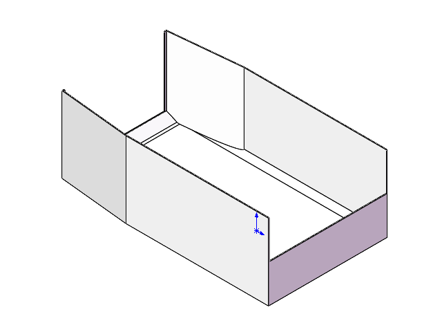

# v3 尾篮详细参数与机械狗安装位置

整理日期：2026-10-27

适用模型：Unitree B2 + Z1，当前默认 v3 尾篮。

当前篮子安装在机械狗背部后半段，左右居中，位于 Z1 机械臂基座后方。本文尺寸及安装位置来自项目现有参数文件、URDF 和外观网格；质量及惯性为仿真设定与计算值。

## 1. 篮子尺寸与结构

本文中的“前端”指朝狗头、靠近机械臂基座的一端，“尾端”指朝狗尾的一端。长度沿机械狗前后方向，宽度沿左右方向，高度沿上下方向。

| 参数 | 当前数值 | 说明 |
| --- | --- | --- |
| 外部总长度 | 450 mm | 沿前后方向 |
| 外部总宽度 | 250 mm | 沿左右方向 |
| 外部总高度 | 160 mm | 从篮底最低外表面到侧壁最高处 |
| 壁厚 | 约 1.5 mm | 当前模型参数 |
| 常规内净宽 | 约 247 mm | 两侧内壁之间，尾口局部除外 |
| 前端挡板高度 | 80 mm | 前端为半高挡板 |
| 前端上方开口净宽 | 约 247 mm | 位于前端挡板上方 |
| 前端上方开口净高 | 约 80 mm | 至侧壁顶部高度 |
| 尾部低沿高度 | 15 mm | 尾部出料边缘 |
| 尾部开口净宽 | 约 210 mm | 尾端局部通道宽度 |
| 尾部主斜面角度 | 约 30° | 相对篮底平面，包含底部过渡段 |
| 空篮质量 | 0.2 kg，即 200 g | 仿真设定值，未经实物测量 |

篮子顶部敞开，两侧高壁约束物料，前端保留半高挡板，尾端采用低沿和局部斜坡，为向后卸料提供通道。30°只描述尾部局部斜面，整个篮子没有倾斜安装。

CAD 形状预览：



## 2. 安装坐标与方向

安装位置以机械狗机身的 `base` link 坐标原点为基准：

- `+x`：朝狗头，即向前。
- `+y`：朝机械狗左侧。
- `+z`：向上。

篮子局部坐标轴与机身坐标轴方向一致。篮子局部原点位于外形包围框底部的平面中心；它不是整个篮子的几何中心或质量中心，也不代表已定义的实物螺栓孔位。

| 安装参数 | 当前数值 | 含义 |
| --- | --- | --- |
| 父 link | `base` | 机械狗机身 |
| 子 link | `tail_basket` | 篮子 |
| 固定关节 | `base_to_tail_basket` | 篮子与机身刚性连接 |
| x 平移 | −0.300 m | 篮子底部参考原点位于机身原点后方 300 mm |
| y 平移 | 0 m | 左右居中 |
| z 平移 | +0.130 m | 篮子底部参考原点位于机身原点上方 130 mm |
| 滚转角 roll | 0 rad | 与机身无相对滚转 |
| 俯仰角 pitch | 0 rad | 与机身无相对俯仰 |
| 偏航角 yaw | 0 rad | 与机身无相对偏航 |

URDF 中的实际安装定义：

```xml
<joint name="base_to_tail_basket" type="fixed" dont_collapse="true">
  <origin xyz="-0.3 0 0.13" rpy="0 0 0" />
  <parent link="base" />
  <child link="tail_basket" />
</joint>
```

对于篮子局部坐标中的点，当前安装变换为：

```text
x_base = x_basket - 0.300
y_base = y_basket
z_base = z_basket + 0.130
```

上述坐标单位均为米。篮子随机身整体运动，没有独立翻转、升降或倾倒自由度。

## 3. 安装后占据的空间

将实际外观网格按安装变换放入机身坐标系，可得到以下范围。数值已按毫米取整。

| 位置 | 相对机身 `base` 原点的坐标 |
| --- | --- |
| 篮子前端 | x = −75 mm |
| 篮子尾端 | x = −525 mm |
| 篮子左侧外边缘 | y = +125 mm |
| 篮子右侧外边缘 | y = −125 mm |
| 篮底最低外表面 | z = +130 mm |
| 侧壁最高处 | z = +290 mm |
| 外形包围框中心 | (−300, 0, +210) mm |

因此，篮子在机身坐标系中的外形包围框为：

```text
x ∈ [−525, −75] mm
y ∈ [−125, +125] mm
z ∈ [+130, +290] mm
```

这里的 130 mm 是相对 `base` 原点的高度，不是相对机身顶面的间隙或篮底离地高度。实际离地高度取决于机身高度、站姿和姿态；机身发生俯仰或滚转时，篮子也随之倾斜。

## 4. 与机械臂的相对位置

Z1 机械臂基座 `link00` 相对 `base` 的安装平移为：

```text
机械臂基座原点：(x, y, z) = (+200, 0, +90) mm
篮子底部参考原点：(x, y, z) = (−300, 0, +130) mm
```

两者沿前后方向相距 500 mm；篮子前端位于机械臂基座原点后方 275 mm。整体布置是前部安装机械臂、后部安装篮子。

下图来自已有独立 MuJoCo 诊断，蓝色部分为当前 v3 尾篮，画面右侧为机械臂基座。图片用于说明模型的相对位置，不作为实物安装、额定载重或整机动力学验收的证据。


## 5. 仿真质量、质心与碰撞参数

| 参数 | 当前配置 |
| --- | --- |
| 外观模型 | 1 个 OBJ 网格 |
| 碰撞模型 | 103 块凸碰撞网格 |
| 碰撞结构 | 保留篮底、侧壁、内部空腔及前后开口 |
| 网格单位 | 米 |
| 空篮质量 | 0.2 kg，设定值 |
| 质心与惯性计算假设 | 按 CAD 壳体均匀质量分布计算 |
| 新增可控关节 | 0 个 |
| 机器人可控关节总数 | 保持 19 个 |

空篮质心：

| 参考坐标系 | 质心坐标，单位 mm |
| --- | --- |
| 篮子局部坐标系 | 约 (−0.7115, +0.0160, +41.2686) |
| 机身 `base` 坐标系 | 约 (−300.7115, +0.0160, +171.2686) |

URDF 惯性张量分量如下，单位为 kg·m²，参考点为上述空篮质心，惯性坐标轴与篮子局部轴一致：

| 分量 | 数值 |
| --- | --- |
| Ixx | 2.459777 × 10⁻³ |
| Iyy | 4.747164 × 10⁻³ |
| Izz | 6.217096 × 10⁻³ |
| Ixy | −1.756103 × 10⁻⁷ |
| Ixz | −8.664485 × 10⁻⁵ |
| Iyz | +1.177530 × 10⁻⁷ |

这些参数描述空篮。装入物料后，还需考虑载荷质量、摆放位置以及由此产生的整机质心变化。

## 6. 实物装配与能力边界

当前模型尚未给出材料牌号、安装支架、螺栓孔位、紧固件规格、实物装配公差、额定载重或经验证的有效装载容量。固定关节表示仿真中的刚性连接，不能替代实物连接结构设计。

几何尺寸来自 CAD 保存的显示三角网格，不是精确曲面 B-rep 重建。现有数字模型与独立试验不能直接证明载物行走、整机平衡、可靠卸料或正式任务入桶成功；本文不将这些项目列为已通过。

## 7. 原始文件

- [当前篮子说明](../assets/b2z1/basket_v3/README.md)
- [尺寸、质量、质心、惯性与哈希参数](../assets/b2z1/basket_v3/basket_properties.json)
- [当前 B2 + Z1 + v3 尾篮 URDF](../assets/b2z1/b2z1_0815_with_basket_v3.urdf)
- [篮子外观网格](../assets/b2z1/meshes/basket_v3/basket_visual.obj)
- [源 CAD：零件2.SLDPRT](../assets/b2z1/basket_v3/零件2.SLDPRT)
