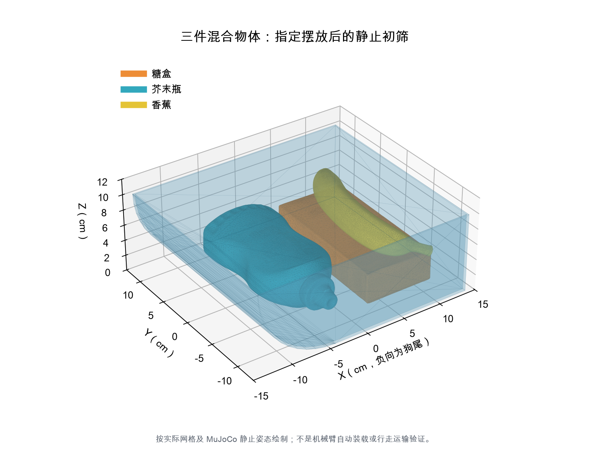
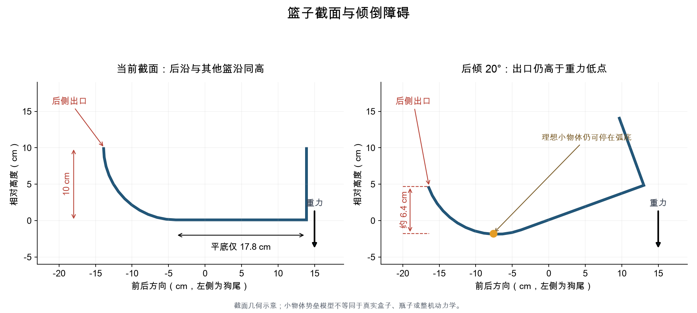

# 当前篮子的容量与倾倒可行性初筛

现已提供本地中文交互窗口：双击项目根目录的 `打开篮子交互仿真.command`，可调整符合 URDF 限位的机身后倾、高度与前后位置，观察货物接触。操作与边界见 [交互仿真使用说明](交互仿真使用说明.md)。机器人姿态由程序规定，尚未验证电机力矩或动态平衡。

结论：现有安装朝向和容纳三件物体的目标基本匹配；目前的高弧形后沿不适合依靠机械狗小幅、缓慢后倾来可靠倒空。建议先改后出口，再设计机身姿态控制。

本次没有修改运行 URDF、行走策略、场景、计分器或终止条件。下列结果分为实际几何计算、腿部逆运动学和独立 MuJoCo 接触初筛，均不能替代 Isaac Sim 中的整机验证。

## 尺寸与可用容积

| 项目 | 当前测量 |
| --- | --- |
| 外尺寸，前后 × 左右 × 高 | 28 × 25 × 10 cm |
| 顶部内开口 | 约 27.6 × 24.6 cm |
| 内深 | 约 9.8 cm |
| 平底区域 | 约 17.8 × 24.6 cm |
| 内腔容积，装到篮沿平面 | **6.1415 L** |
| 壁厚 | 约 2 mm |
| 篮子质量 | 指定值 0.2 kg |
| 三件物体质量 | 1.5 kg；连篮合计 1.7 kg |

容积由实际 CAD 网格的内截面凸多边形面积乘内宽得到，弧面按当前网格的 12 段计算。7 L 是外包围盒体积，不是可用容量；篮沿以内 6.14 L 也不等于散装物体可以完全利用的空间。物体长边约 17.6–19.7 cm，比平底前后长度更长，装载姿态会显著影响容量。

## 三件物体能否放下

使用原有三个 USD 的实际网格作为外形、以凸包接触近似，每件质量 0.5 kg，在独立 MuJoCo 场景内按指定方案放置并静置。采用实际篮子的 16 块碰撞体，不使用填满内部空腔的整体凸包。

| 指定摆放案例 | 静置后留在篮内 | 最高点离篮沿的最小余量，约 |
| --- | --- | --- |
| 糖盒、芥末瓶、香蕉各一件 | 3/3 | 13.2 mm |
| 三个糖盒，局部叠放 | 3/3 | 6.8 mm |
| 三个芥末瓶，窄边朝下并排 | 3/3 | **2.2 mm** |
| 三根香蕉，沿内宽方向排列 | 3/3 | 51.9 mm |

这些是某一指定摆放下的存在性结果，不是最大装载量、随机抓放成功率或行走运输能力。几何包含判定容许 3 mm 误差，未验证夹爪能否自动实现这些摆放；瓶子案例尤其紧，不能把“能放下”理解为“走路也不掉”。三件混合物体是当前合理的工作目标；更多数量需要另外搜索摆放并做运输测试。



## 为什么弧形端仍不容易卸货

弧形端从底面一直上翻到 10 cm 高的篮沿，最后一段接近竖直。底板后倾只会让物体移向弧形低处，不会自动消除向后越过篮沿的障碍。

在理想小物体、无惯性冲击的截面模型中，后倾 20° 后，出口仍比弧面上的重力低点高约 6.4 cm。物体可能停在这个低点。有限尺寸物体会发生滚转、翻倒、相互支撑，所以不能用这个小物体模型推导真实物体的精确倾倒角；下面另用网格接触仿真作了筛查。



### 独立接触仿真结果

使用 **MuJoCo 3.17.0**，每次静置 2 s，随后用 5 s 平滑改变篮子坐标系下的重力方向，再保持 3 s。该方法近似缓慢、规定角度的篮子倾斜，没有让机械狗动起来，也不包含篮子随机身运动产生的惯性力。没有测试摇晃、甩动或抛掷卸料。

篮子采用实际 16 块碰撞体，三件物体沿用源网格的凸包外形和各 0.5 kg 质量。步长 0.001 s；线性和角阻尼分别近似为 2/s 和 4/s。摩擦系数 0.2、0.5、1.0 是敏感性参数，不是对塑料的实测值，也没有写回正式环境。

以下为从尾部**整个外形完全离开篮子**的件数：

| 滑动摩擦系数 | 15° | 20° | 30° | 45° | 60° | 75° |
| --- | --- | --- | --- | --- | --- | --- |
| 0.2 | 0/3 | 0/3 | 0/3 | 0/3 | 0/3 | 0/3 |
| 0.5 | 0/3 | 0/3 | 0/3 | 0/3 | 0/3 | 1/3 |
| 1.0 | 0/3 | 0/3 | 0/3 | 0/3 | 0/3 | 0/3 |

每格只有一个指定摆放案例，不应据此估计成功概率，也不应把这些角度当成精确阈值。出现非单调结果可能与物体姿态、滚转及相互卡住有关。另以 120°、摩擦 0.5 做数值流程自检时三件全部排出；这只是证明检测流程能识别排出，绝不是机械狗可执行的姿态。

结果支持的结论是：**当前结构对小幅缓慢后倾卸料不友好**。它不证明任何可能的动态动作都无法卸料，也没有验证进入目标桶。

## 机械狗姿态的几何必要条件

根据当前 URDF 的四条 Rx/Ry/Ry 腿链作精确逆运动学，保持四个脚球中心在默认站姿的固定位置。扫描机身前后平移 ±15 cm、高度 30–65 cm，间距 2.5 mm；保留 2° 关节限位余量，机身/髋/大腿与地面至少间隔 1 cm，质心投影位于四足中心支持多边形内且留 2 cm 余量。

为对接项目的目标桶，还要求后口沿至少高 57 cm，即超过现有 55 cm 桶沿 2 cm。质量与质心来自当前 URDF，额外 1.5 kg 货物按偏后位置作静态几何假设。

| 后倾角 | 扫描范围内找到满足上述条件的姿态 | 该候选姿态出口高度 | 最小关节限位余量 |
| --- | --- | --- | --- |
| 10° | 是 | 约 68.8 cm | 约 10.6° |
| 15° | 是 | 约 64.6 cm | 约 9.0° |
| 20° | 是 | 约 61.1 cm | 约 2.0° |
| 25° | 是；候选范围已很窄 | 约 57.3 cm | 约 2.0° |
| 30° | 未找到同时满足关节余量与出口高度的候选 | — | — |

“找到”只说明几何必要条件可满足。这里没有验证关节力矩、足端接触力分配、脚滑、姿态控制、自碰撞或动态稳定性；“未找到”也不证明换站位、移动脚或改变扫描范围后绝无解。现有行走控制器只有速度命令，没有机身俯仰角接口，不能直接命令这些姿态。

数值说明了两个问题：25° 左右已同时受腿部限位和桶沿高度约束；而载物初筛中 15–30° 均未排出。这两部分之间存在明显的设计不匹配。

## 下一版优先修改什么

1. 保留较高的前壁和两侧壁，给尾部设置真正较低的出口，避免整段弧面一直上翻到 10 cm 高。
2. 把末端改成坡度较小、向后伸出的卸料通道，同时检查运输时防漏。只增大圆角半径不一定解决末端过陡的问题。
3. 先确定可以稳定实现的机身倾角和篮子/物体的有效摩擦，再设计出口坡度。降低出口本身也不能保证摩擦较大时物体会滑动。
4. 卸料口伸出长度与高度要同时适配目标桶，避免后蹲时出口低于桶沿。

本次没有据此替换用户的设计。建议将现版保留作对照，以同一套诊断比较下一版。

## 在 Isaac Sim 中如何验收

当前电脑没有 Isaac Sim；尚未完成以下正式验证：

1. 单独验证篮子：沿用实际目标物体和接触参数，在受控测试场景内检查 0° 保持，以及缓慢倾斜时的滑移、卡住和完全离篮。规定角度的篮子运动仅用于检查结构，不证明整机可执行。
2. 验证空篮整机：使用真实腿关节目标和姿态反馈依次尝试 5°、10°、15°，确认足端不滑、关节不顶限、没有非法接触，再考虑 20°。不能通过直接改机器人根姿态来宣称腿部控制成功。
3. 验证三件载物整机：先保持和缓慢行走，再停车倾倒并回正；记录漏货、跌倒、关节限位、接触、出口高度以及最终进入桶内的情况。
4. 更换装载位置、方向和物体组合重复测试，报告尝试次数及成功条件。一次摆放或一张截图不能证明可靠运输与倾倒。

NVIDIA 说明实际接触摩擦由接触双方物理材质及 combine mode 共同决定：[Physics Simulation Fundamentals](https://docs.isaacsim.omniverse.nvidia.com/latest/physics/simulation_fundamentals.html#contacts-and-friction)。MuJoCo 的网格接触和惯性推断见其 [XML Reference](https://mujoco.readthedocs.io/en/stable/XMLreference.html#asset-mesh)。本次保留两个引擎的区别，不把独立初筛写成 Isaac Sim 测试结果。

## 复现与原始数据

需在独立 Python 环境安装 `numpy scipy matplotlib mujoco`；读取 USD 还需 `usd-core` 或可执行的 `usdcat`。这些诊断依赖没有加入正式策略或启动流程。

从 TaskB 根目录运行：

```bash
python reports/basket_feasibility/geometry_scan.py
python reports/basket_feasibility/contact_screen.py
python reports/basket_feasibility/make_figures.py
```

几何与姿态数据在 `geometry_scan.json`；接触初筛、初始摆放位姿与检测结果在 `contact_screen.json`。`contact_*.xml` 为独立 MuJoCo 诊断场景；`screen_meshes/` 为从原有 USD 提取的米制网格。所有这些文件均未接入计分策略。
