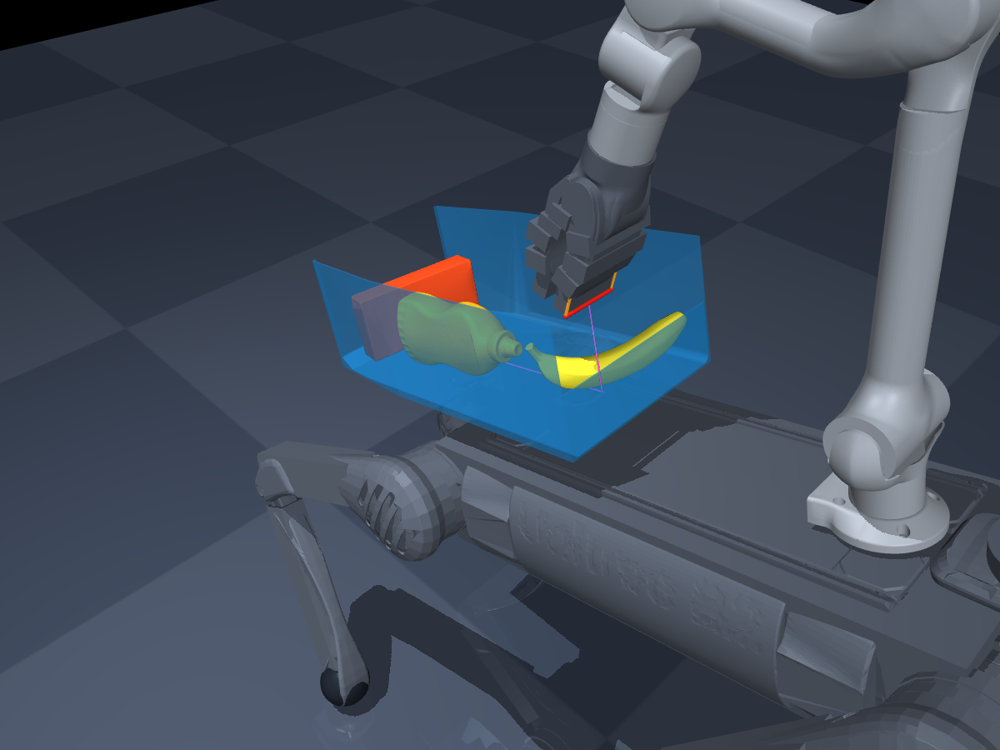
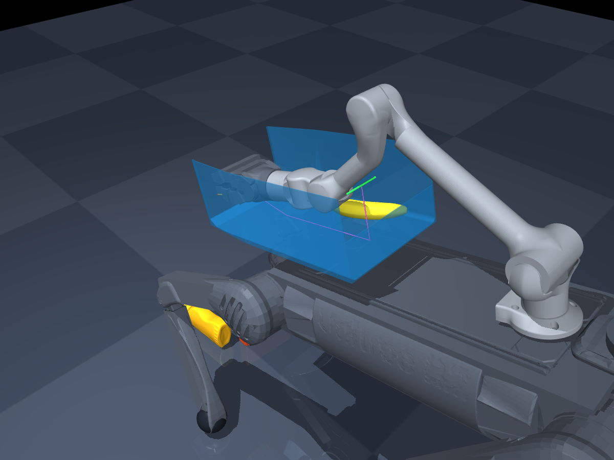

# v3 篮子：随机三件物料原路径测试

**当前抽样完整卸料达标 2/12 组，关节保护停止 7/12 组。**

固定原轨迹，每组随机位置、朝向与放置顺序；共 12 组、36 件。

| 组合 | seed | 末态越界 | 其中提前滑出 | 动作完成 | 关节保护 | 完整卸料达标 |
| --- | ---: | ---: | ---: | --- | --- | --- |
| 混合三件 | 20261026 | 2/3 | 1 | 是 | 未触发 | 否 |
| 混合三件 | 20261027 | 0/3 | 0 | 否 | 实际机械臂速度超限 | 否 |
| 混合三件 | 20261028 | 0/3 | 0 | 否 | 实际机械臂速度超限 | 否 |
| 三个糖盒 | 20261126 | 1/3 | 0 | 否 | 实际机械臂速度超限 | 否 |
| 三个糖盒 | 20261127 | 3/3 | 1 | 是 | 未触发 | 否 |
| 三个糖盒 | 20261128 | 2/3 | 0 | 否 | 实际机械臂速度超限 | 否 |
| 三个芥末瓶 | 20261226 | 2/3 | 1 | 是 | 未触发 | 否 |
| 三个芥末瓶 | 20261227 | 3/3 | 0 | 是 | 未触发 | 是 |
| 三个芥末瓶 | 20261228 | 1/3 | 0 | 否 | 实际机械臂速度超限 | 否 |
| 三根香蕉 | 20261326 | 0/3 | 0 | 否 | 实际机械臂速度超限 | 否 |
| 三根香蕉 | 20261327 | 0/3 | 0 | 否 | 实际机械臂速度超限 | 否 |
| 三根香蕉 | 20261328 | 3/3 | 0 | 是 | 未触发 | 是 |

原动作完整执行 5/12 组。末态完整越过尾部平面 17/36 件，其中 3 件在动作前的沉降阶段已经滑出；动作后新增越界 14 件。提前滑出不能当作原路径卸料成功。

## 观察到的问题

- 7 次保护由 jointGripper 的下一步实际速度超过 0.25 rad/s 触发；保持原限速，回退到上一个有效状态后停止，没有放宽限制继续播放。
- 检查各组 `trace.json` 的物料轮廓和位置，可区分侧边残留、尾部卡料与提前滑出。
- 出现动作前滑出的组，需要单独验证装载保持；不能仅用末态越界数量判断路径成功。

## 保护触发记录

| seed | 拒绝步时间（s） | 夹爪拒绝步速度（rad/s） | 限值（rad/s） |
| ---: | ---: | ---: | ---: |
| 20261027 | 51.399 | -0.481867 | 0.25 |
| 20261028 | 30.603 | +0.250872 | 0.25 |
| 20261126 | 96.497 | +0.270829 | 0.25 |
| 20261128 | 98.144 | +0.416017 | 0.25 |
| 20261228 | 90.281 | +0.386725 | 0.25 |
| 20261326 | 41.290 | -0.495703 | 0.25 |
| 20261327 | 90.502 | +0.268197 | 0.25 |

结果中的峰值速度/力矩统计接受的有效步；拒绝步单独保存在 `rejected_next_step`，因此有效步峰值低于限值与触发保护并不矛盾。

## 试验设置

- v3 原篮子与原关节轨迹；后倾 15°、前移 10 cm、机身高 57.5 cm。
- 摩擦 0.5；每件质量沿用既有诊断的 0.5 kg；目标峰值速度 0.02 rad/s。
- 每组始终是三件：一盒一瓶一香蕉，或三个同类。不同 seed 独立抽样。
- 从六个轴向静置姿态和连续随机偏航角抽样；按物体尺寸拒绝放不下的姿态。
- 初始整件位于篮内，离侧面至少约 5 mm，离底约 3 mm；物体之间至少 3 mm，初态无穿透。
- 只按初始几何接受/拒绝摆放，不按执行结果重抽；先自由沉降 2 秒，再运行原路径。
- 每 1 ms 检查实际关节角度、速度和力矩；超限时沿用原保护，停在上一个有效状态。
- 尾部越界检测 50 Hz；回放姿态和曲线每 0.1 秒记录；失败的下一步另存完整信息。
- 卸出定义：整件位于篮子局部 X < -0.230 m；全部成功还要求没有提前掉落、动作完成且保护未触发。

## 复现

```sh
.venv-basket/bin/python scripts/basket_random_trials.py --seed 20261026 --trials-per-scenario 3
.venv-basket/bin/python scripts/basket_random_trials.py --view reports/basket_v3/random_three_2026-10-26/mixed_three_seed_20261026
```

每组目录包含初态布局、完整结果、采样轨迹和实际姿态回放。`summary.json` 保存所有组及资产哈希校验。

本次实际运行脚本快照为 `runner_used.py`，其哈希与 `summary.json` 中 `script_sha256` 一致。篮子、原轨迹、物料网格、正式策略与规则等 116 个受保护文件在测试前后哈希一致。

## 适用范围

这是规定机身姿态下的 MuJoCo 机械臂/物料动力学试验。物料仅在明确初始化时设置姿态，运动中没有吸附、外力辅助或瞬移。没有目标桶，不能计为 Task B 入桶或得分；整机反作用平衡、行走、收臂到准备位及 Isaac/PhysX 仍需分别验证。每个组合 3 次的样本只用于发现问题，不构成对所有随机摆放的成功率估计。

## 本次重点复核

混合 seed=20261026：糖盒在沉降阶段提前滑出；香蕉与夹爪接触后停在侧边，末态中心约 Y=8.6 cm。中央宽 7.7 cm 的铲边后续没有补扫。三个糖盒 seed=20261127 的末态虽然为 3/3，但包含一件提前滑出。严格达标的两组为三个芥末瓶 seed=20261227、三根香蕉 seed=20261328。

独立 3D 回放可双击项目根目录的 `打开随机三件路径测试.command`；已完成相同的 2 秒沉降，点击“继续”执行原轨迹。聊天中的局部回放按 1 秒采样，原始姿态文件按 0.1 秒采样。

第一组随机初态：



同组末态，香蕉留在篮子侧边：


